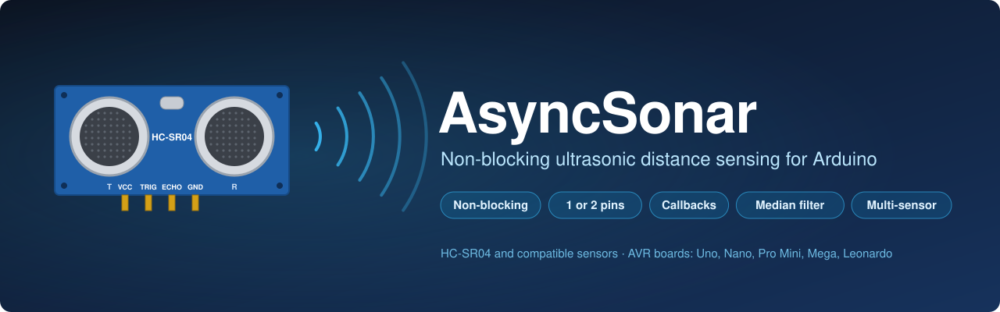
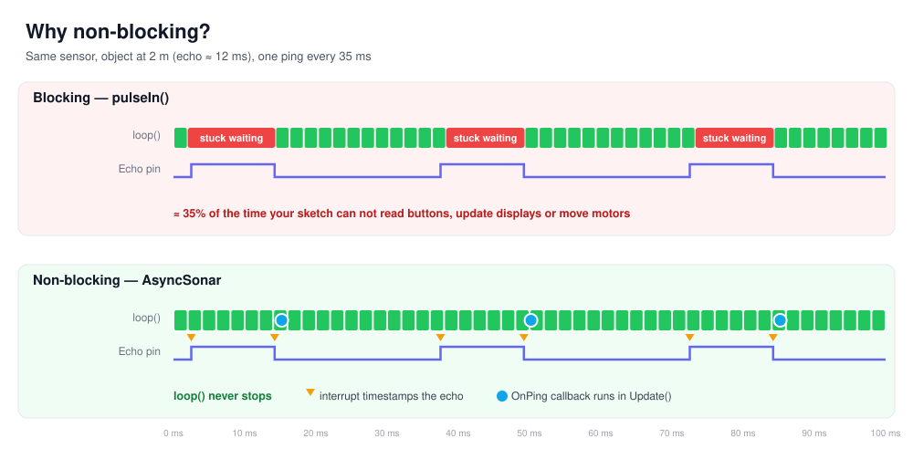
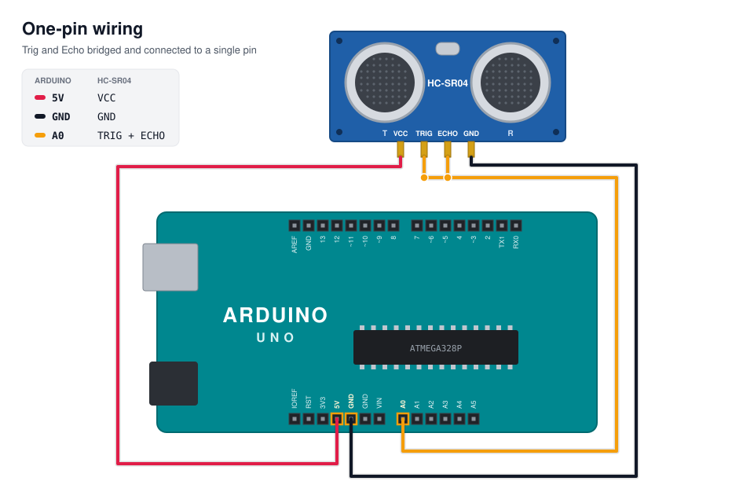
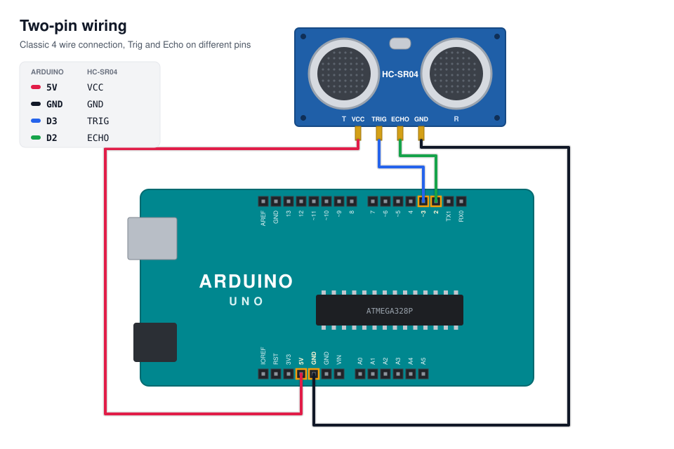
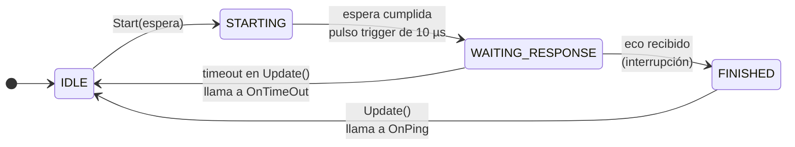
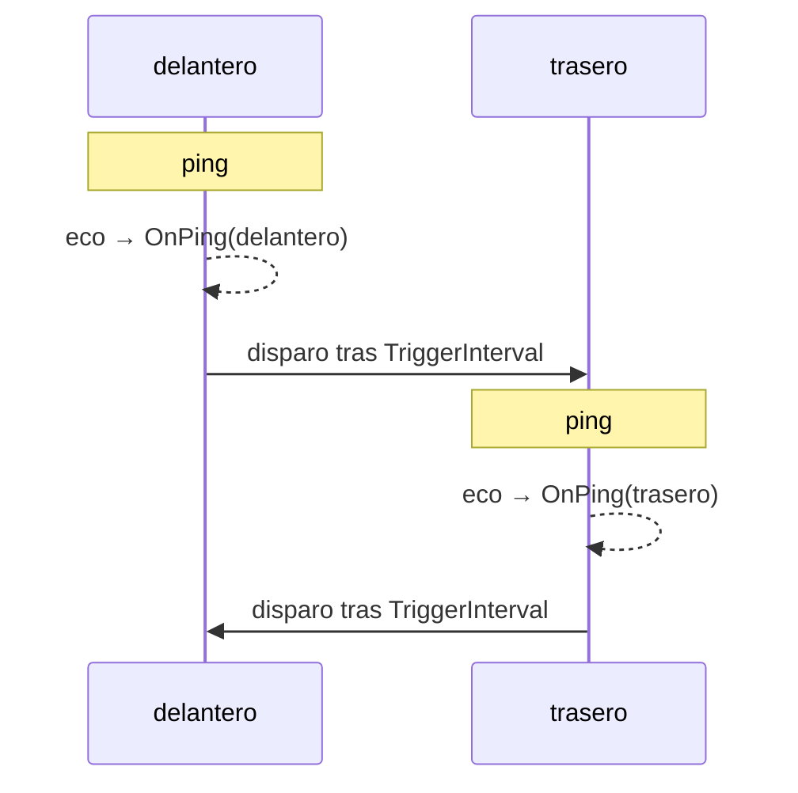

<p align="center">
  
</p>

<p align="center">
  <a href="https://github.com/luisllamasbinaburo/Arduino-AsyncSonar/actions/workflows/compile-examples.yml"></a>
  <a href="https://www.ardu-badge.com/AsyncSonar"></a>
  <a href="LICENSE"></a>
  
</p>

<p align="center">
  <a href="README.md">English</a> · <b>Español</b>
</p>

---

**AsyncSonar** lee un **HC-SR04** (o cualquier sensor de ultrasonidos compatible con Trig/Echo) **sin bloquear tu sketch**.
Mientras el sonido viaja hasta el objeto y vuelve, tu `loop()` sigue leyendo pulsadores, refrescando pantallas y moviendo motores.
Cuando llega el eco, se llama a tu función de callback con el resultado.

```cpp
#include <AsyncSonarLib.h>

AsyncSonar sonar(A0, [](AsyncSonar& s) {   // Trig + Echo unidos en el pin A0
  Serial.println(s.GetMeasureMM());         // se llama cada vez que hay una medición
});

void setup() {
  Serial.begin(115200);
  sonar.Start();
}

void loop() {
  sonar.Update(&sonar);   // mide continuamente, nunca bloquea
  // ... el resto de tu código se ejecuta libremente
}
```

## Contenido

- [¿Por qué AsyncSonar?](#por-qué-asyncsonar)
- [Características](#características)
- [Instalación](#instalación)
- [Conexionado](#conexionado)
- [Primeros pasos](#primeros-pasos)
- [Cómo funciona](#cómo-funciona)
- [Guía de uso](#guía-de-uso)
- [Referencia de la API](#referencia-de-la-api)
- [Ejemplos](#ejemplos)
- [Solución de problemas](#solución-de-problemas)
- [Historial de cambios](#historial-de-cambios)
- [Licencia](#licencia)

## ¿Por qué AsyncSonar?

La forma habitual de leer un HC-SR04 es `pulseIn()`, que **congela el microcontrolador** hasta que vuelve el eco.
Con un objeto a 2 m son unos 12 ms por medición; sin nada delante del sensor pueden ser **más de 30 ms**.
Midiendo de forma continua, tu sketch pasa un tercio del tiempo sin hacer nada.

<p align="center">
  
</p>

AsyncSonar lanza el pulso de disparo y vuelve inmediatamente. Una **interrupción por cambio de pin** (PCINT) registra el inicio y el fin del eco, y la siguiente llamada a `Update()` entrega el resultado a tu callback.

## Características

- ⚡ **No bloqueante**: el `loop()` nunca se detiene esperando el eco.
- 🔌 **Uno o dos pines**: Trig y Echo en el mismo pin (¡ahorra pines!) o en pines separados.
- 📞 **Callbacks** para medición válida, para timeout, y una opcional que se ejecuta directamente en la interrupción.
- 🔗 **Encadenado**: varios sensores se disparan uno tras otro automáticamente, sin escuchar los ecos de los demás.
- 📏 Resultados en **milímetros** o **microsegundos**.
- 🌡️ **Corrección por temperatura** de la velocidad del sonido.
- 🧹 **Filtro de mediana** rápido de 5 muestras para eliminar picos.
- ⏱️ **Timeout** configurable (por tiempo o por distancia máxima) e **intervalo** entre disparos.
- 🪶 **No usa timers hardware**: compatible con `Servo`, `tone()`, PWM, etc.

## Instalación

AsyncSonar depende de [Yet Another Arduino PcInt Library](https://github.com/paulo-raca/YetAnotherArduinoPcIntLibrary) de Paulo Costa, que gestiona las interrupciones por cambio de pin.

### IDE de Arduino (recomendado)

1. Abre **Programa → Incluir librería → Administrar bibliotecas…** (o el icono de librerías en Arduino IDE 2).
2. Busca **AsyncSonar** y pulsa **Instalar**.
3. Cuando lo pregunte, elige **Instalar todo** para instalar también *Yet Another Arduino PcInt Library*.

### Manual (ZIP)

1. Descarga este repositorio como ZIP (**Code → Download ZIP**) y añádelo con **Programa → Incluir librería → Añadir biblioteca .ZIP…**
2. Haz lo mismo con [YetAnotherArduinoPcIntLibrary](https://github.com/paulo-raca/YetAnotherArduinoPcIntLibrary).

### PlatformIO

```ini
lib_deps =
    https://github.com/luisllamasbinaburo/Arduino-AsyncSonar.git
    https://github.com/paulo-raca/YetAnotherArduinoPcIntLibrary.git
```

### Placas compatibles

AsyncSonar funciona en **placas AVR** (Arduino Uno, Nano, Pro Mini, Mega 2560, Leonardo, Micro…), porque usa las interrupciones por cambio de pin de AVR.
ESP8266, ESP32, SAMD, RP2040 y otras arquitecturas no están soportadas.

## Conexionado

El HC-SR04 necesita **5 V**. Conecta `VCC` a `5V` y `GND` a `GND`, y después elige una de estas opciones.

### Opción A: un pin (Trig y Echo unidos)

Une los pines `TRIG` y `ECHO` del sensor con un cable corto y conéctalos a **un único pin de Arduino**.
AsyncSonar envía el pulso de disparo como salida y después cambia el pin a entrada para escuchar el eco.

<p align="center">
  
</p>

```cpp
AsyncSonar sonar(A0, OnPing, OnTimeOut);
```

### Opción B: dos pines (conexión clásica)

Conecta `TRIG` y `ECHO` a dos pines distintos. Usa esta opción si el modo de un pin no funciona con tu módulo.

<p align="center">
  
</p>

```cpp
AsyncSonar sonar(3, 2, OnPing, OnTimeOut);   // pin trigger, pin echo
```

### ¿Qué pines puedo usar?

El **pin Echo** (en modo un pin, el único pin) debe admitir **interrupciones por cambio de pin (PCINT)**:

| Placa | Pines Echo válidos |
|---|---|
| Uno, Nano, Pro Mini (ATmega328P) | **Cualquier pin**: D2–D13, A0–A5 (evita D0/D1, usados por `Serial`) |
| Mega 2560 | 10, 11, 12, 13, 50, 51, 52, 53, A8–A15 |
| Leonardo, Micro (ATmega32U4) | 8, 9, 10, 11, 14 (MISO), 15 (SCK), 16 (MOSI) |

El pin Trigger (modo dos pines) puede ser cualquier pin digital.

## Primeros pasos

1. Conecta el sensor con la [opción A](#opción-a-un-pin-trig-y-echo-unidos) en el pin `A0`.
2. Abre **Archivo → Ejemplos → AsyncSonar → AsyncChain**.
3. Súbelo y abre el Monitor Serie a **115200 baudios**.

Verás la distancia en milímetros, y una línea `TIME` cada segundo que demuestra que el resto del sketch sigue funcionando:

```text
Ping: 412 mm
Ping: 410 mm
Ping: 411 mm
  TIME: 1000
Ping: 409 mm
...
```

## Cómo funciona

Cada objeto `AsyncSonar` es una pequeña máquina de estados. Tu sketch sólo llama a `Start()` una vez y luego a `Update()` tan a menudo como pueda.



1. `Start()` envía el pulso de disparo de 10 µs (inmediatamente, o tras la espera en milisegundos que le pases).
2. La interrupción guarda `micros()` en el flanco de **subida** y en el de **bajada** del eco. No hace nada más, así que es muy rápida.
3. `Update()` comprueba el estado. Si el eco ha terminado, calcula la distancia y llama a `OnPing`. Si ha vencido el timeout, llama a `OnTimeOut`.
4. Si pasas otro sensor a `Update(&otro)`, ese sensor se dispara automáticamente. Pasando el mismo sensor (`sonar.Update(&sonar)`) se mide de forma continua.

## Guía de uso

### Crear el sensor

```cpp
// Modo un pin
AsyncSonar sonar(pin, onPing, onTimeOut, onPingISR);

// Modo dos pines
AsyncSonar sonar(triggerPin, echoPin, onPing, onTimeOut, onPingISR);
```

Todas las callbacks son opcionales (`nullptr` por defecto). Reciben el sensor que las ha llamado:

```cpp
void onPing(AsyncSonar& sonar)
{
  Serial.println(sonar.GetMeasureMM());
}
```

También puedes usar lambdas sin captura, como en el ejemplo del principio.

### Iniciar y detener

```cpp
sonar.Start();       // disparar ahora
sonar.Start(500);    // disparar dentro de 500 ms (útil en setup(), mientras arranca el sensor)
sonar.Stop();        // cancelar la medición en curso
```

### Actualizar

Llama a `Update()` en cada iteración del `loop()`. **Las callbacks se ejecutan dentro de `Update()`**, no en la interrupción, así que puedes usar `Serial`, `delay()` o cualquier otra función en ellas.

```cpp
sonar.Update();          // medición única: se detiene tras el resultado
sonar.Update(&sonar);    // continuo: vuelve a disparar tras cada resultado
sonar.Update(&otro);     // encadenado: dispara 'otro' tras cada resultado
```

> [!TIP]
> Cuanto más a menudo llames a `Update()`, antes se ejecutará tu callback. Evita `delay()` largos en el `loop()`.
> Si necesitas reaccionar con la mínima latencia incluso con un `loop()` lento, usa la [callback en la ISR](#reaccionar-dentro-de-la-interrupción).

### Leer el resultado

| Función | Devuelve | ¿Incluye timeouts? |
|---|---|---|
| `GetMeasureMM()` / `GetMeasureUS()` | Última medición **válida** | No: mantiene el último valor válido |
| `GetFilteredMM()` / `GetFilteredUS()` | **Mediana** de las 5 últimas mediciones válidas | No |
| `GetRawMM()` / `GetRawUS()` | Último resultado, sea el que sea | Sí: un timeout devuelve la distancia/tiempo de timeout |

Las funciones `MM` devuelven milímetros y las `US` el tiempo del eco en microsegundos (ida y vuelta).

```cpp
void onPing(AsyncSonar& sonar)
{
  float cm = sonar.GetFilteredMM() / 10.0;
}
```

El filtro de mediana elimina picos aislados (un problema habitual en los sensores de ultrasonidos) manteniendo una respuesta rápida:

| Mediciones | 412 | 409 | **1850** | 411 | 410 |
|---|---|---|---|---|---|
| `GetMeasureMM()` | 412 | 409 | **1850** | 411 | 410 |
| `GetFilteredMM()` | 412 | 412 | 412 | 412 | 411 |

También puedes consultar el estado del sensor en cualquier momento con `GetStatus()`, que devuelve `IDLE`, `STARTING`, `WAITING_RESPONSE` o `FINISHED`.

### Varios sensores

Cuando dos sensores de ultrasonidos se disparan a la vez, cada uno puede recibir el eco del otro. AsyncSonar lo evita **encadenándolos**: cada sensor dispara el siguiente cuando termina.

```cpp
AsyncSonar delantero(A0, onPing);
AsyncSonar trasero(A1, onPing);

void setup()
{
  Serial.begin(115200);
  delantero.Start(500);
}

void loop()
{
  delantero.Update(&trasero);   // cuando 'delantero' termina, dispara 'trasero'
  trasero.Update(&delantero);   // cuando 'trasero' termina, dispara 'delantero'
}
```



La cadena puede ser tan larga como quieras: `a.Update(&b); b.Update(&c); c.Update(&a);`.
En una callback compartida, compara direcciones para saber qué sensor la ha llamado: `if (&sonar == &delantero) { ... }`.

### Reaccionar dentro de la interrupción

El cuarto argumento del constructor (quinto en modo dos pines) es una callback que se ejecuta **dentro de la interrupción**, justo cuando termina el eco, aunque el `loop()` esté ocupado:

```cpp
void onPingISR(AsyncSonar& sonar)
{
  digitalWrite(LED_BUILTIN, sonar.GetRawMM() < 200);   // obstáculo a menos de 20 cm
}

AsyncSonar sonar(A0, onPing, onTimeOut, onPingISR);
```

> [!WARNING]
> Mantén las callbacks de ISR **muy cortas**: sin `Serial`, sin `delay()`, sin cálculos largos. Usa `GetRawMM()` / `GetRawUS()` dentro de ellas (`GetMeasure` y `GetFiltered` se actualizan después, en `Update()`).

### Configuración

```cpp
sonar.SetTemperatureCorrection(28);   // temperatura ambiente en °C (por defecto 20 °C)
sonar.SetTimeOutDistance(2000);       // abandonar más allá de 2000 mm...
sonar.SetTimeOut(15);                 // ...o directamente en ms (por defecto 25 ms ≈ 4,3 m)
sonar.SetTriggerInterval(60);         // ms entre disparos al encadenar (por defecto 35 ms)
```

- La velocidad del sonido cambia unos 0,6 m/s por °C: entre 0 °C y 35 °C el error es de un 6 %. Si tienes un sensor de temperatura, actualiza la corrección periódicamente.
- Llama a `SetTemperatureCorrection()` **antes** que a `SetTimeOutDistance()`, porque el timeout se calcula con la velocidad del sonido actual.
- Un timeout más corto permite medir más rápido cuando sólo te interesan objetos cercanos.
- El intervalo de disparo se cuenta desde el **inicio** del ping anterior. La hoja de datos del HC-SR04 recomienda al menos 60 ms para evitar ecos fantasma de objetos lejanos.

### Opciones de compilación (`src/Config.h`)

| Opción | Efecto |
|---|---|
| `#define ASYNCSONAR_DISABLE_MEDIAN` | Elimina el filtro de mediana y ahorra 22 bytes de RAM por sensor. |

## Referencia de la API

### Constructores

| Firma | Descripción |
|---|---|
| `AsyncSonar(uint8_t pin, SonarCallback onPing = nullptr, SonarCallback onTimeOut = nullptr, SonarCallback onPingISR = nullptr)` | Modo un pin. |
| `AsyncSonar(uint8_t triggerPin, uint8_t echoPin, SonarCallback onPing = nullptr, SonarCallback onTimeOut = nullptr, SonarCallback onPingISR = nullptr)` | Modo dos pines. |

`SonarCallback` es `void (*)(AsyncSonar&)`.

### Métodos

| Método | Descripción |
|---|---|
| `void Start()` | Disparar ahora. |
| `void Start(unsigned long esperaMs)` | Disparar tras `esperaMs` milisegundos. |
| `void Stop()` | Cancelar la medición en curso. |
| `void Update()` | Procesar el estado y llamar a las callbacks. Llámalo continuamente. |
| `void Update(AsyncSonar* siguiente)` | Igual, y dispara `siguiente` al terminar la medición (puede ser el mismo sensor). |
| `AsyncSonarStatus GetStatus()` | `IDLE`, `STARTING`, `WAITING_RESPONSE` o `FINISHED`. |
| `unsigned int GetMeasureMM()` | Última distancia válida, mm. |
| `unsigned long GetMeasureUS()` | Último tiempo de eco válido, µs. |
| `unsigned int GetFilteredMM()` | Mediana de las 5 últimas distancias válidas, mm. |
| `unsigned long GetFilteredUS()` | Mediana de los 5 últimos tiempos de eco válidos, µs. |
| `unsigned int GetRawMM()` | Último resultado incluyendo timeouts, mm. |
| `unsigned long GetRawUS()` | Último resultado incluyendo timeouts, µs. |
| `void SetTemperatureCorrection(int8_t celsius)` | Corregir la velocidad del sonido según la temperatura ambiente. |
| `void SetTimeOut(unsigned int ms)` | Tiempo máximo de espera del eco. |
| `void SetTimeOutDistance(unsigned int mm)` | Tiempo máximo de espera, expresado como distancia. |
| `void SetTriggerInterval(unsigned int ms)` | Tiempo entre disparos cuando el sensor se dispara desde una cadena. |

### Campos públicos

| Campo | Descripción |
|---|---|
| `TriggerPin`, `EchoPin` | Pines en uso (iguales en modo un pin). |
| `OnPing`, `OnTimeOut`, `SonarISR` | Callbacks. Se pueden cambiar en tiempo de ejecución. |

## Ejemplos

Todos los ejemplos están disponibles en el IDE de Arduino en **Archivo → Ejemplos → AsyncSonar**.

| Ejemplo | Descripción |
|---|---|
| [SyncSimple](examples/SyncSimple/SyncSimple.ino) | Uso bloqueante, el sketch más sencillo posible. |
| [SyncWithCallback](examples/SyncWithCallback/SyncWithCallback.ino) | Uso bloqueante con callbacks. |
| [AsyncSingle](examples/AsyncSingle/AsyncSingle.ino) | Una medición no bloqueante. |
| [AsyncContinuous](examples/AsyncContinuous/AsyncContinuous.ino) | Mediciones continuas, relanzando desde callbacks lambda. |
| [AsyncChain](examples/AsyncChain/AsyncChain.ino) | Mediciones continuas encadenando el sensor consigo mismo, mientras se ejecutan otras tareas. |
| [AsyncChainMedian](examples/AsyncChainMedian/AsyncChainMedian.ino) | Valor bruto frente a filtrado por mediana, listo para el Serial Plotter. |
| [AsyncChainMultiple](examples/AsyncChainMultiple/AsyncChainMultiple.ino) | Dos sensores disparados alternativamente. |
| [AsyncISR](examples/AsyncISR/AsyncISR.ino) | Alarma de proximidad que reacciona dentro de la interrupción, incluso con un `loop()` lento. |
| [TwoPins](examples/TwoPins/TwoPins.ino) | Conexión clásica Trig + Echo, con distancia de timeout e intervalo de disparo. |

## Solución de problemas

<details>
<summary><b>Siempre obtengo <code>TimeOut</code></b></summary>

- Comprueba que el sensor está alimentado a **5 V**.
- Comprueba que el pin Echo admite interrupciones por cambio de pin en tu placa (ver [¿Qué pines puedo usar?](#qué-pines-puedo-usar)). En Mega y Leonardo, `A0` **no** es válido.
- Si usas el modo un pin, prueba la conexión de dos pines: algunos módulos no funcionan con Trig y Echo unidos.
- Aumenta el timeout: `SetTimeOut(40)`. El valor por defecto (25 ms) son unos 4,3 m.
</details>

<details>
<summary><b>Los valores saltan o aparecen distancias grandes aleatorias</b></summary>

- Usa `GetFilteredMM()` en lugar de `GetMeasureMM()`.
- Aumenta el intervalo entre disparos: `SetTriggerInterval(60)`. Los ecos de un disparo anterior pueden llegar tarde.
- Con varios sensores, encadénalos siempre; nunca los dispares a la vez.
- Las superficies blandas o inclinadas (tela, espuma, objetos a más de ~30°) reflejan muy poco sonido.
</details>

<details>
<summary><b>Mi callback nunca se llama</b></summary>

- Asegúrate de llamar a `Update()` en el `loop()` y de que el `loop()` no esté bloqueado.
- Con `Update()` (sin argumento) el sensor mide **una vez**. Usa `Update(&sonar)` o vuelve a llamar a `Start()` para mediciones continuas.
</details>

<details>
<summary><b>Error de compilación: <code>multiple definition of __vector_3</code> (o 4, 5)</b></summary>

Otra librería de tu sketch (por ejemplo `SoftwareSerial` o `PinChangeInterrupt`) también usa las interrupciones por cambio de pin, y sólo una librería puede controlarlas. Usa un puerto serie hardware (o `AltSoftSerial`) en lugar de `SoftwareSerial`.
</details>

<details>
<summary><b>¿Funciona en ESP8266 / ESP32 / Arduino Due…?</b></summary>

Todavía no. AsyncSonar usa las interrupciones por cambio de pin de AVR a través de YetAnotherPcInt, que sólo existe para microcontroladores AVR.
</details>

## Historial de cambios

### 1.1.0

- **Nuevo**: modo dos pines, `AsyncSonar(triggerPin, echoPin, ...)`.
- **Nuevo**: `GetStatus()`.
- **Nuevo**: la callback de ISR está siempre disponible; ya no hace falta editar `Config.h` (`ASYNCSONAR_USE_SONARISR` ya no tiene efecto).
- **Nuevo**: ejemplo [TwoPins](examples/TwoPins/TwoPins.ino).
- **Corregido**: `SetTimeOutDistance()` establecía el doble del tiempo pedido.
- **Corregido**: `GetRawMM()` / `GetRawUS()` ahora informan de los timeouts, como estaba documentado.
- **Corregido**: el filtro de mediana devolvía valores erróneos durante las 5 primeras mediciones, y podía contener basura en objetos no globales.
- **Corregido**: condición de carrera cuando el eco llegaba justo a la vez que el timeout.
- **Corregido**: los valores de 32 bits compartidos con la interrupción se leen ahora de forma atómica.
- **Corregido**: el ejemplo `AsyncContinuous` no compilaba, y se detenía tras el primer timeout.
- **Corregido**: el ejemplo `AsyncISR` no compilaba sin editar `Config.h`, y usaba `Serial` dentro de la interrupción.
- `library.properties`: arquitectura restringida a `avr` (la única que soporta la dependencia), categoría `Sensors`.
- `keywords.txt` actualizado.

### 1.0.0

- Primera versión.

## Licencia

Copyright (c) 2018 [Luis Llamas](https://www.luisllamas.es).
Publicada bajo la [Licencia Apache 2.0](LICENSE).

Más información en [luisllamas.es/libreria-arduino-asyncsonar](https://www.luisllamas.es/libreria-arduino-asyncsonar/).
