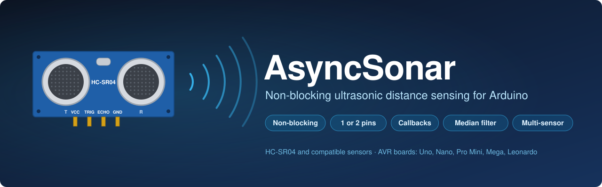
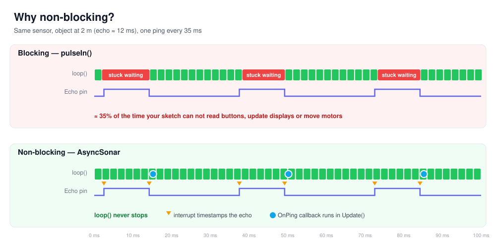
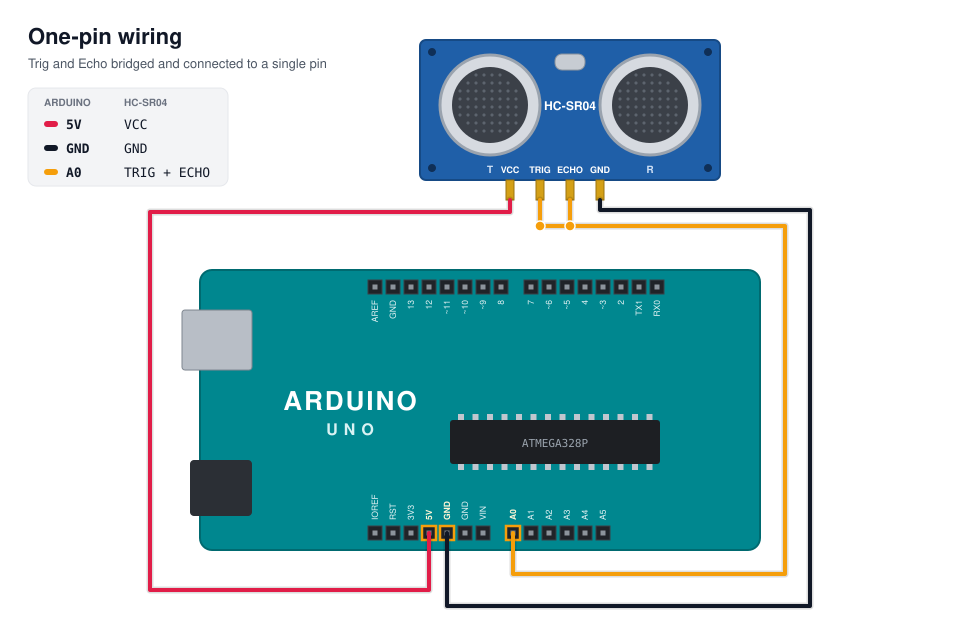
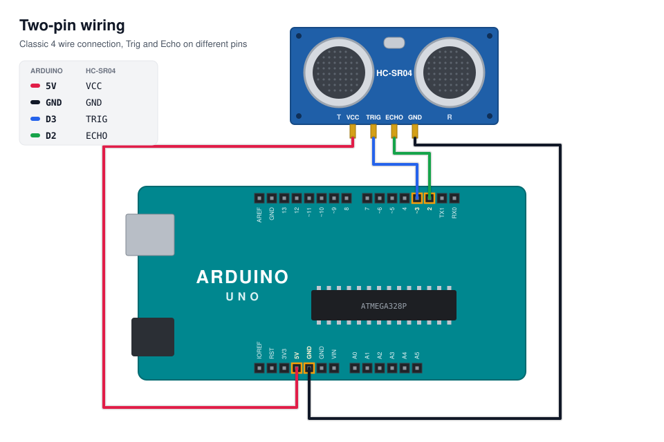
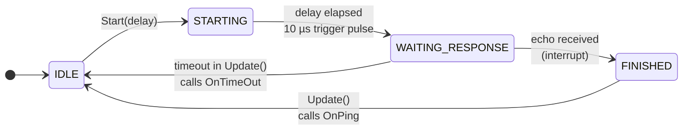
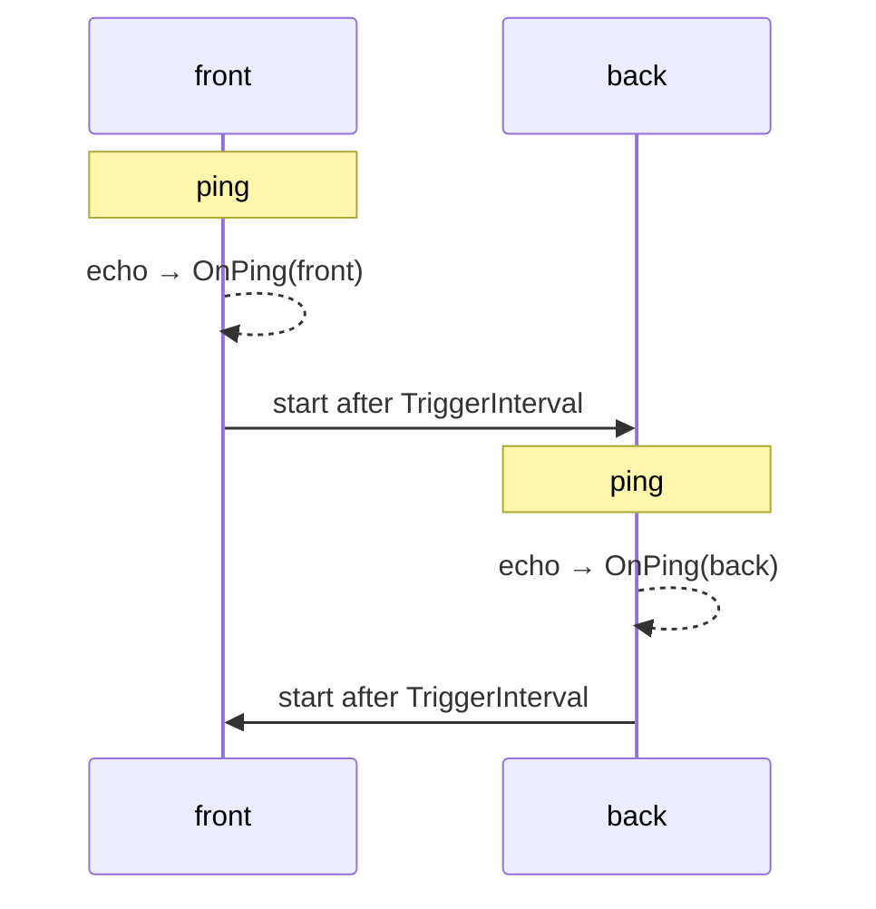

<p align="center">
  
</p>

<p align="center">
  <a href="https://github.com/luisllamasbinaburo/Arduino-AsyncSonar/actions/workflows/compile-examples.yml"></a>
  <a href="https://www.ardu-badge.com/AsyncSonar"></a>
  <a href="LICENSE"></a>
  
</p>

<p align="center">
  <b>English</b> · <a href="README.es.md">Español</a>
</p>

---

**AsyncSonar** reads an **HC-SR04** (or any compatible Trig/Echo ultrasonic sensor) **without blocking your sketch**.
While the sound travels to the object and back, your `loop()` keeps reading buttons, refreshing displays and moving motors.
When the echo arrives, your callback is called with the result.

```cpp
#include <AsyncSonarLib.h>

AsyncSonar sonar(A0, [](AsyncSonar& s) {   // Trig + Echo bridged on pin A0
  Serial.println(s.GetMeasureMM());         // called each time a measure is ready
});

void setup() {
  Serial.begin(115200);
  sonar.Start();
}

void loop() {
  sonar.Update(&sonar);   // keep measuring, never blocks
  // ... the rest of your code runs freely
}
```

## Contents

- [Why AsyncSonar?](#why-asyncsonar)
- [Features](#features)
- [Installation](#installation)
- [Wiring](#wiring)
- [Quick start](#quick-start)
- [How it works](#how-it-works)
- [User guide](#user-guide)
- [API reference](#api-reference)
- [Examples](#examples)
- [Troubleshooting](#troubleshooting)
- [Changelog](#changelog)
- [License](#license)

## Why AsyncSonar?

The usual way to read an HC-SR04 is `pulseIn()`, which **freezes the microcontroller** until the echo returns.
With an object at 2 m that is about 12 ms per measure; with nothing in front of the sensor it can be **more than 30 ms**.
Measuring continuously, your sketch spends a third of its time doing nothing.

<p align="center">
  
</p>

AsyncSonar fires the trigger pulse and returns immediately. A **pin change interrupt** timestamps the start and the end of the echo, and the next call to `Update()` delivers the result to your callback.

## Features

- ⚡ **Non-blocking**: `loop()` is never stopped waiting for the echo.
- 🔌 **One or two pins**: Trig and Echo on the same pin (saves pins!) or on separate pins.
- 📞 **Callbacks** for a valid measure, for a timeout, and an optional one that runs directly in the interrupt.
- 🔗 **Chaining**: several sensors fire one after another automatically, so they never hear each other's echoes.
- 📏 Results in **millimetres** or **microseconds**.
- 🌡️ **Temperature correction** of the speed of sound.
- 🧹 Fast **5-sample median filter** to remove spikes.
- ⏱️ Configurable **timeout** (by time or by maximum distance) and **interval** between pings.
- 🪶 **No hardware timers used**: compatible with `Servo`, `tone()`, PWM, etc.

## Installation

AsyncSonar depends on [Yet Another Arduino PcInt Library](https://github.com/paulo-raca/YetAnotherArduinoPcIntLibrary) by Paulo Costa, which handles the pin change interrupts.

### Arduino IDE (recommended)

1. Open **Sketch → Include Library → Manage Libraries…** (or the library icon in Arduino IDE 2).
2. Search for **AsyncSonar** and click **Install**.
3. When asked, choose **Install all** to also install *Yet Another Arduino PcInt Library*.

### Manual (ZIP)

1. Download this repository as ZIP (**Code → Download ZIP**) and add it with **Sketch → Include Library → Add .ZIP Library…**
2. Do the same with [YetAnotherArduinoPcIntLibrary](https://github.com/paulo-raca/YetAnotherArduinoPcIntLibrary).

### PlatformIO

```ini
lib_deps =
    https://github.com/luisllamasbinaburo/Arduino-AsyncSonar.git
    https://github.com/paulo-raca/YetAnotherArduinoPcIntLibrary.git
```

### Compatible boards

AsyncSonar works on **AVR boards** (Arduino Uno, Nano, Pro Mini, Mega 2560, Leonardo, Micro…), because it relies on AVR pin change interrupts.
ESP8266, ESP32, SAMD, RP2040 and other architectures are not supported.

## Wiring

The HC-SR04 needs **5 V**. Connect `VCC` to `5V` and `GND` to `GND`, and then choose one of these options.

### Option A: one pin (Trig and Echo bridged)

Join the `TRIG` and `ECHO` pins of the sensor with a short wire and connect them to **a single Arduino pin**.
AsyncSonar sends the trigger pulse as an output and then switches the pin to input to listen for the echo.

<p align="center">
  
</p>

```cpp
AsyncSonar sonar(A0, OnPing, OnTimeOut);
```

### Option B: two pins (classic wiring)

Connect `TRIG` and `ECHO` to two different pins. Use this option if one-pin mode does not work with your module.

<p align="center">
  
</p>

```cpp
AsyncSonar sonar(3, 2, OnPing, OnTimeOut);   // trigger pin, echo pin
```

### Which pins can I use?

The **Echo pin** (in one-pin mode, the only pin) must support **pin change interrupts (PCINT)**:

| Board | Valid Echo pins |
|---|---|
| Uno, Nano, Pro Mini (ATmega328P) | **Any pin**: D2–D13, A0–A5 (avoid D0/D1, used by `Serial`) |
| Mega 2560 | 10, 11, 12, 13, 50, 51, 52, 53, A8–A15 |
| Leonardo, Micro (ATmega32U4) | 8, 9, 10, 11, 14 (MISO), 15 (SCK), 16 (MOSI) |

The Trigger pin (two-pin mode) can be any digital pin.

## Quick start

1. Wire the sensor using [option A](#option-a-one-pin-trig-and-echo-bridged) on pin `A0`.
2. Open **File → Examples → AsyncSonar → AsyncChain**.
3. Upload it and open the Serial Monitor at **115200 baud**.

You will see the distance in millimetres, and a `TIME` line every second showing that the rest of the sketch keeps running:

```text
Ping: 412 mm
Ping: 410 mm
Ping: 411 mm
  TIME: 1000
Ping: 409 mm
...
```

## How it works

Each `AsyncSonar` object is a small state machine. Your sketch only calls `Start()` once and then `Update()` as often as possible.



1. `Start()` sends the 10 µs trigger pulse (immediately, or after the delay you pass in milliseconds).
2. The interrupt saves `micros()` on the **rising** and on the **falling** edge of the echo. Nothing else is done inside the interrupt, so it is very fast.
3. `Update()` checks the state. If the echo has finished, it computes the distance and calls `OnPing`. If the timeout has expired, it calls `OnTimeOut`.
4. If you passed another sensor to `Update(&other)`, that sensor is started automatically. Passing the same sensor (`sonar.Update(&sonar)`) measures continuously.

## User guide

### Creating the sensor

```cpp
// One pin mode
AsyncSonar sonar(pin, onPing, onTimeOut, onPingISR);

// Two pins mode
AsyncSonar sonar(triggerPin, echoPin, onPing, onTimeOut, onPingISR);
```

All the callbacks are optional (`nullptr` by default). They receive the sensor that called them:

```cpp
void onPing(AsyncSonar& sonar)
{
  Serial.println(sonar.GetMeasureMM());
}
```

Captureless lambdas work too, as shown in the example at the top.

### Starting and stopping

```cpp
sonar.Start();       // ping now
sonar.Start(500);    // ping in 500 ms (useful in setup(), while the sensor powers up)
sonar.Stop();        // cancel the current measure
```

### Updating

Call `Update()` in every iteration of `loop()`. **Callbacks are executed inside `Update()`**, not in the interrupt, so you can safely use `Serial`, `delay()` or any other function in them.

```cpp
sonar.Update();          // single measure: stops after the result
sonar.Update(&sonar);    // continuous: starts again after each result
sonar.Update(&other);    // chain: starts 'other' after each result
```

> [!TIP]
> The more often you call `Update()`, the sooner your callback runs. Avoid long `delay()` calls in `loop()`.
> If you need to react with minimum latency even with a slow `loop()`, use the [ISR callback](#reacting-inside-the-interrupt).

### Reading the result

| Function | Returns | Includes timeouts? |
|---|---|---|
| `GetMeasureMM()` / `GetMeasureUS()` | Last **valid** measure | No: keeps the last valid value |
| `GetFilteredMM()` / `GetFilteredUS()` | **Median** of the last 5 valid measures | No |
| `GetRawMM()` / `GetRawUS()` | Last result, whatever it was | Yes: a timeout returns the timeout distance/time |

`MM` functions return millimetres, `US` functions return the echo time in microseconds (round trip).

```cpp
void onPing(AsyncSonar& sonar)
{
  float cm = sonar.GetFilteredMM() / 10.0;
}
```

The median filter removes isolated spikes (a common problem with ultrasonic sensors) while keeping a fast response:

| Measures | 412 | 409 | **1850** | 411 | 410 |
|---|---|---|---|---|---|
| `GetMeasureMM()` | 412 | 409 | **1850** | 411 | 410 |
| `GetFilteredMM()` | 412 | 412 | 412 | 412 | 411 |

You can also check the state of the sensor at any time with `GetStatus()`, which returns `IDLE`, `STARTING`, `WAITING_RESPONSE` or `FINISHED`.

### Several sensors

When two ultrasonic sensors fire at the same time, each one can receive the echo of the other. AsyncSonar avoids it by **chaining** them: each sensor starts the next one when it finishes.

```cpp
AsyncSonar front(A0, onPing);
AsyncSonar back(A1, onPing);

void setup()
{
  Serial.begin(115200);
  front.Start(500);
}

void loop()
{
  front.Update(&back);    // when 'front' finishes, start 'back'
  back.Update(&front);    // when 'back' finishes, start 'front'
}
```



The chain can be as long as you want: `a.Update(&b); b.Update(&c); c.Update(&a);`.
In a shared callback, compare addresses to know which sensor called it: `if (&sonar == &front) { ... }`.

### Reacting inside the interrupt

The fourth (or fifth, in two-pin mode) constructor argument is a callback that runs **inside the interrupt**, right when the echo ends, even if `loop()` is busy:

```cpp
void onPingISR(AsyncSonar& sonar)
{
  digitalWrite(LED_BUILTIN, sonar.GetRawMM() < 200);   // obstacle closer than 20 cm
}

AsyncSonar sonar(A0, onPing, onTimeOut, onPingISR);
```

> [!WARNING]
> Keep ISR callbacks **very short**: no `Serial`, no `delay()`, no long calculations. Use `GetRawMM()` / `GetRawUS()` inside them (`GetMeasure` and `GetFiltered` are updated later, in `Update()`).

### Configuration

```cpp
sonar.SetTemperatureCorrection(28);   // ambient temperature in °C (default 20 °C)
sonar.SetTimeOutDistance(2000);       // give up beyond 2000 mm...
sonar.SetTimeOut(15);                 // ...or directly in ms (default 25 ms ≈ 4.3 m)
sonar.SetTriggerInterval(60);         // ms between pings when chaining (default 35 ms)
```

- The speed of sound changes about 0.6 m/s per °C: between 0 °C and 35 °C the error is about 6%. If you have a temperature sensor, update the correction periodically.
- Call `SetTemperatureCorrection()` **before** `SetTimeOutDistance()`, since the timeout is calculated with the current speed of sound.
- A shorter timeout allows faster measures when you only care about close objects.
- The trigger interval is counted from the **start** of the previous ping. The HC-SR04 datasheet recommends at least 60 ms to avoid ghost echoes from distant objects.

### Compile options (`src/Config.h`)

| Option | Effect |
|---|---|
| `#define ASYNCSONAR_DISABLE_MEDIAN` | Removes the median filter and saves 22 bytes of RAM per sensor. |

## API reference

### Constructors

| Signature | Description |
|---|---|
| `AsyncSonar(uint8_t pin, SonarCallback onPing = nullptr, SonarCallback onTimeOut = nullptr, SonarCallback onPingISR = nullptr)` | One-pin mode. |
| `AsyncSonar(uint8_t triggerPin, uint8_t echoPin, SonarCallback onPing = nullptr, SonarCallback onTimeOut = nullptr, SonarCallback onPingISR = nullptr)` | Two-pin mode. |

`SonarCallback` is `void (*)(AsyncSonar&)`.

### Methods

| Method | Description |
|---|---|
| `void Start()` | Ping now. |
| `void Start(unsigned long delayMs)` | Ping after `delayMs` milliseconds. |
| `void Stop()` | Cancel the current measure. |
| `void Update()` | Process the state and call the callbacks. Call it continuously. |
| `void Update(AsyncSonar* next)` | Same, and start `next` when the measure finishes (it can be the same sensor). |
| `AsyncSonarStatus GetStatus()` | `IDLE`, `STARTING`, `WAITING_RESPONSE` or `FINISHED`. |
| `unsigned int GetMeasureMM()` | Last valid distance, mm. |
| `unsigned long GetMeasureUS()` | Last valid echo time, µs. |
| `unsigned int GetFilteredMM()` | Median of the last 5 valid distances, mm. |
| `unsigned long GetFilteredUS()` | Median of the last 5 valid echo times, µs. |
| `unsigned int GetRawMM()` | Last result including timeouts, mm. |
| `unsigned long GetRawUS()` | Last result including timeouts, µs. |
| `void SetTemperatureCorrection(int8_t celsius)` | Correct the speed of sound for the ambient temperature. |
| `void SetTimeOut(unsigned int ms)` | Maximum time to wait for the echo. |
| `void SetTimeOutDistance(unsigned int mm)` | Maximum time to wait, expressed as a distance. |
| `void SetTriggerInterval(unsigned int ms)` | Time between pings when this sensor is started by a chain. |

### Public fields

| Field | Description |
|---|---|
| `TriggerPin`, `EchoPin` | Pins in use (equal in one-pin mode). |
| `OnPing`, `OnTimeOut`, `SonarISR` | Callbacks. They can be changed at runtime. |

## Examples

All the examples are available in the Arduino IDE in **File → Examples → AsyncSonar**.

| Example | Description |
|---|---|
| [SyncSimple](examples/SyncSimple/SyncSimple.ino) | Blocking use, the simplest possible sketch. |
| [SyncWithCallback](examples/SyncWithCallback/SyncWithCallback.ino) | Blocking use with callbacks. |
| [AsyncSingle](examples/AsyncSingle/AsyncSingle.ino) | One non-blocking measure. |
| [AsyncContinuous](examples/AsyncContinuous/AsyncContinuous.ino) | Continuous measures, restarting from lambda callbacks. |
| [AsyncChain](examples/AsyncChain/AsyncChain.ino) | Continuous measures by chaining the sensor to itself, while other tasks run. |
| [AsyncChainMedian](examples/AsyncChainMedian/AsyncChainMedian.ino) | Raw vs median-filtered values, ready for the Serial Plotter. |
| [AsyncChainMultiple](examples/AsyncChainMultiple/AsyncChainMultiple.ino) | Two sensors fired alternately. |
| [AsyncISR](examples/AsyncISR/AsyncISR.ino) | Proximity alarm reacting inside the interrupt, even with a slow `loop()`. |
| [TwoPins](examples/TwoPins/TwoPins.ino) | Classic Trig + Echo wiring, with timeout distance and trigger interval. |

## Troubleshooting

<details>
<summary><b>I always get <code>TimeOut</code></b></summary>

- Check that the sensor is powered with **5 V**.
- Check that the Echo pin supports pin change interrupts on your board (see [Which pins can I use?](#which-pins-can-i-use)). On Mega and Leonardo, `A0` is **not** valid.
- If you use one-pin mode, try the two-pin wiring: some modules do not work with Trig and Echo bridged.
- Increase the timeout: `SetTimeOut(40)`. The default (25 ms) is about 4.3 m.
</details>

<details>
<summary><b>The values jump or show random large distances</b></summary>

- Use `GetFilteredMM()` instead of `GetMeasureMM()`.
- Increase the interval between pings: `SetTriggerInterval(60)`. Echoes from a previous ping can arrive late.
- With several sensors, always chain them; never fire them at the same time.
- Soft or angled surfaces (fabric, foam, objects at more than ~30°) reflect very little sound.
</details>

<details>
<summary><b>My callback is never called</b></summary>

- Make sure `Update()` is called in `loop()` and `loop()` is not blocked.
- With `Update()` (no argument) the sensor measures **once**. Use `Update(&sonar)` or call `Start()` again for continuous measures.
</details>

<details>
<summary><b>Compile error: <code>multiple definition of __vector_3</code> (or 4, 5)</b></summary>

Another library in your sketch (for example `SoftwareSerial` or `PinChangeInterrupt`) is also using the pin change interrupts. Only one library can own them. Use a hardware serial port (or `AltSoftSerial`) instead of `SoftwareSerial`.
</details>

<details>
<summary><b>Does it work on ESP8266 / ESP32 / Arduino Due…?</b></summary>

Not yet. AsyncSonar uses AVR pin change interrupts through YetAnotherPcInt, which only exists for AVR microcontrollers.
</details>

## Changelog

### 1.1.0

- **New**: two-pin mode, `AsyncSonar(triggerPin, echoPin, ...)`.
- **New**: `GetStatus()`.
- **New**: the ISR callback is always available, it is no longer necessary to edit `Config.h` (`ASYNCSONAR_USE_SONARISR` has no effect now).
- **New**: [TwoPins](examples/TwoPins/TwoPins.ino) example.
- **Fix**: `SetTimeOutDistance()` set twice the requested time.
- **Fix**: `GetRawMM()` / `GetRawUS()` now report timeouts, as documented.
- **Fix**: median filter returned wrong values during the first 5 measures, and could contain garbage in non-global objects.
- **Fix**: race condition when the echo arrived at the same moment as the timeout.
- **Fix**: 32-bit values shared with the interrupt are now read atomically.
- **Fix**: `AsyncContinuous` example did not compile, and stopped after the first timeout.
- **Fix**: `AsyncISR` example did not compile without editing `Config.h`, and used `Serial` inside the interrupt.
- `library.properties`: architecture restricted to `avr` (the only one supported by the dependency), category `Sensors`.
- `keywords.txt` updated.

### 1.0.0

- First release.

## License

Copyright (c) 2018 [Luis Llamas](https://www.luisllamas.es).
Released under the [Apache License 2.0](LICENSE).

More information (in Spanish) at [luisllamas.es/libreria-arduino-asyncsonar](https://www.luisllamas.es/libreria-arduino-asyncsonar/).
